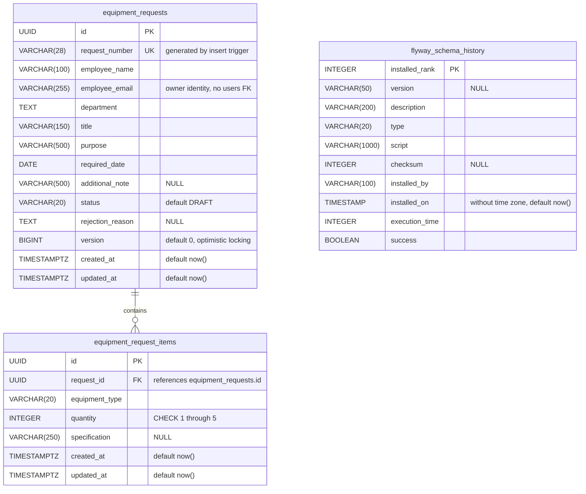

# Database schema — ITMS

ตรวจจาก PostgreSQL ฐานข้อมูล `itms`, schema `public` ใน Docker Compose เมื่อ 30/09/2026 (Asia/Bangkok) และเทียบกับ Flyway V1–V3 ซึ่ง apply สำเร็จทั้งหมด.

## Tables และ relationships

`PK` = Primary Key, `FK` = Foreign Key, `UK` = Unique Key. ช่องที่ระบุ `NULL` เว้นค่าได้; ช่องอื่นเป็น `NOT NULL`.

- `equipment_requests` → `equipment_request_items` เป็น **1 : 0..N**. Draft ไม่มีอุปกรณ์ได้; ตอน Submit application บังคับให้มีอย่างน้อยหนึ่ง Item. Foreign Key เพียงอย่างเดียวไม่ได้บังคับจำนวนขั้นต่ำนี้.
- แต่ละ Item ต้องมี Request หนึ่งรายการผ่าน `request_id NOT NULL`; constraint `fk_item_request` ใช้ `ON DELETE CASCADE`.
- JPA ใช้ `OneToMany` / `ManyToOne`, `cascade = ALL` และ `orphanRemoval = true`; เมื่อเอา Item ออกจาก collection และบันทึก จะลบ Item นั้นออกจาก DB.
- `flyway_schema_history` เป็นตารางประวัติ migrations ที่ Flyway จัดการ ไม่มี Foreign Key กับตารางธุรกิจ.

## Constraints และค่าที่สร้างอัตโนมัติ

| ส่วน | ข้อกำหนดปัจจุบัน |
|---|---|
| Request / Item `id` | UUID สร้างใน application; ไม่มี DB default |
| `request_number` | `NOT NULL`, unique constraint `uq_request_number`; trigger `trg_generate_request_number` เรียก `generate_request_number()` เมื่อ INSERT ส่งค่า NULL หรือค่าว่าง |
| Sequence | `equipment_request_number_seq`: BIGINT, เริ่ม 1, เพิ่มครั้งละ 1, `NO CYCLE`; เลขไม่ reset เมื่อเปลี่ยนปีและมีช่องว่างได้ |
| รูปแบบเลขคำขอ | `REQ-YYYY-NNNNNN`; ปีตาม Asia/Bangkok, sequence เติมศูนย์อย่างน้อย 6 หลักและไม่ตัดเลขที่ยาวกว่า |
| `status` | `chk_status`: DRAFT / PENDING / APPROVED / REJECTED / CANCELLED; default DRAFT |
| `equipment_type` | `chk_equipment_type`: NOTEBOOK / MONITOR / KEYBOARD / MOUSE / HEADSET / OTHER |
| `quantity` | `chk_quantity`: จำนวนเต็ม 1–5 |
| `version` | BIGINT default 0; JPA `@Version` ใช้ตรวจ optimistic locking |
| Timestamps ธุรกิจ | `TIMESTAMPTZ NOT NULL DEFAULT now()`; application callbacks ตั้ง `created_at` / `updated_at` และปรับ `updated_at` เมื่อแก้ข้อมูล |

## Indexes

นอกเหนือจาก Primary Key ของทั้งสามตารางและ unique index ของ `request_number`:

| ตาราง | Index | รูปแบบ / columns |
|---|---|---|
| equipment_requests | idx_requests_employee_email | B-tree (`employee_email`) |
| equipment_requests | idx_requests_status | B-tree (`status`) |
| equipment_requests | idx_requests_department | Hash (`department`) |
| equipment_requests | idx_requests_created_at | B-tree (`created_at DESC`) |
| equipment_requests | idx_requests_employee_email_status | B-tree (`employee_email`, `status`) |
| equipment_requests | idx_requests_request_number_trgm | GIN (`lower(request_number)` gin_trgm_ops) |
| equipment_requests | idx_requests_title_trgm | GIN (`lower(title)` gin_trgm_ops) |
| equipment_requests | idx_requests_employee_name_trgm | GIN (`lower(employee_name)` gin_trgm_ops) |
| equipment_request_items | idx_items_request_id | B-tree (`request_id`) |
| flyway_schema_history | flyway_schema_history_s_idx | B-tree (`success`) |

GIN trigram indexes ใช้ PostgreSQL extension `pg_trgm`. Schema ล่าสุดใช้ `department TEXT` / Hash index และ `request_number VARCHAR(28)` ตาม V2–V3.

## ข้อมูลที่ไม่ได้เป็นตารางหรือ column

- ไม่มีตาราง Users/Approvers: Login เป็น simulation; `employee_email` เก็บ owner email และไม่ได้อ้าง Foreign Key ไป users table.
- `totalItems` คำนวณจาก `SUM(equipment_request_items.quantity)` ไม่ใช่จำนวนแถว และไม่ได้เก็บเป็น column.
- Redis เก็บ detail cache และ Caffeine เก็บ list cache; ทั้งสองส่วนอยู่นอก relational schema นี้.
